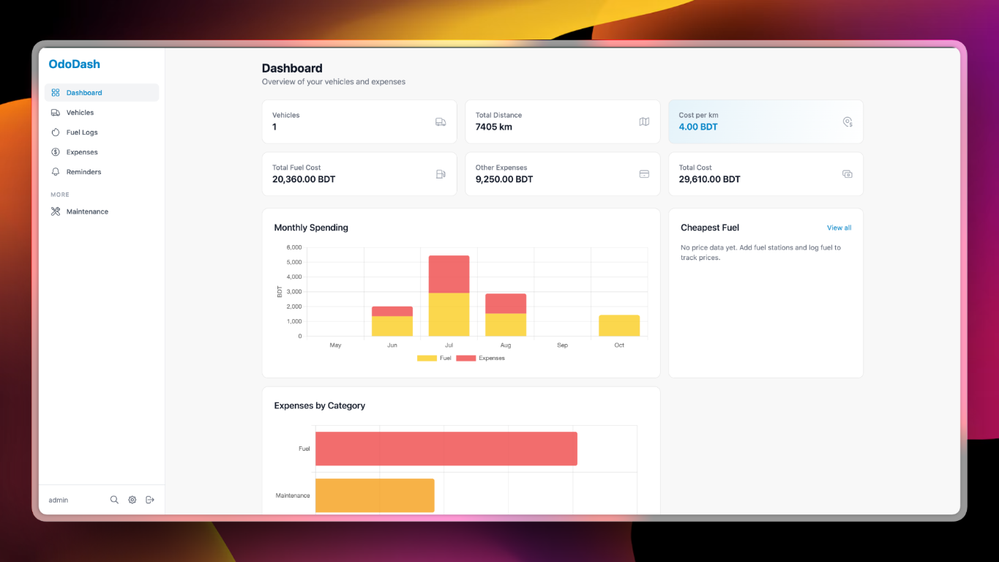

# OdoDash 🚗💨

*A gorgeous, self-hosted vehicle management dashboard optimized for the ultimate user experience. Track fuel, expenses, maintenance, and trips without the clutter.*

> 💡 **Notice:** OdoDash is an actively maintained, designer-led friendly fork of the wonderful [May](https://github.com/dannymcc/may) project by [Danny McClelland](https://github.com/dannymcc). We are deeply grateful for the foundational codebase. This fork is dedicated to continuous UX/UI enhancements, active bug fixes, and community-driven features.

    

## Why OdoDash

OdoDash tracks fuel, expenses, reminders and maintenance across your whole fleet. The original May project is an excellent backend; OdoDash adds a simpler, more modern and more responsive interface on top.

- **Designer-led UX/UI:** refreshed spacing, typography and a modern dark and light palette.
- **Streamlined logging:** fuel and expense forms need fewer clicks, with limits checked as you type.
- **Mobile and PWA:** app-like navigation on phones.
- **Active maintenance:** upstream bugs and useful PRs are merged here quickly.

<p align="center">
  
</p>

## Features

- 🚗 **Multi-vehicle:** cars, vans, motorbikes and scooters, shared between users with roles
- ⛽ **Fuel and EV charging:** automatic consumption (L/100km, MPG), quick entry mode, favourite stations
- 💰 **Expenses:** by category, plus recurring payments such as insurance and tax
- 🔧 **Maintenance and tires:** schedules by mileage, hours or date, with tire set history
- 🧭 **Trips and reminders:** mileage logs, MOT/service/tax reminders by email, ntfy, Pushover or webhook
- 📁 **Documents and receipts:** attach files to vehicles, fuel logs and expenses
- 📊 **Analytics and PDF reports:** spending trends, consumption charts, printable vehicle reports
- 🎨 **Customisable:** dark mode, branding, units, many currencies and 20 languages
- 🔌 **Integrations:** REST API, Home Assistant, calendar subscription, UK fuel prices, DVLA lookup
- 📥 **Import and export:** May backups, Fuelly CSV, JSON and CSV export
- 🐳 **Self-hosted:** Docker and PWA ready

## Quick Start

```bash
git clone https://github.com/moshiur-hridoy/OdoDash.git
cd OdoDash
docker compose up -d
```

Open `http://localhost:5050` and sign in as `admin`. Unless you set `ADMIN_PASSWORD`, the generated password is printed once in the logs (`docker logs ododash`). Change it after your first login.

Without Docker:

```bash
python3 -m venv venv && source venv/bin/activate
pip install -r requirements.txt
pybabel compile -d app/translations
python run.py
```

More options (plain `docker run`, first-login details) are in the [installation guide](docs/installation.md).

## Documentation

| Guide | Contents |
| --- | --- |
| [Installation](docs/installation.md) | Docker, Compose, manual install, first login |
| [Configuration](docs/configuration.md) | `.env`, environment variables, PUID/PGID |
| [Usage](docs/usage.md) | Every feature, from fuel logs to import and restore |
| [Administration](docs/administration.md) | Admin settings, user roles, REST API |
| [Integrations](docs/integrations.md) | UK fuel prices, Home Assistant, calendar |
| [Languages](docs/translations.md) | Supported languages, improving and adding translations |
| [Troubleshooting](docs/troubleshooting.md) | Common problems and fixes |
| [Changelog](CHANGELOG.md) | What changed in each release |

## Tech Stack

Python / Flask, SQLite or PostgreSQL, Tailwind CSS, HTMX, Chart.js, Gunicorn, WeasyPrint.

## Contributing

Contributions are welcome. OdoDash is a designer-led project, so UI/UX ideas, animations, logo design and feedback are as valuable as code. Please read [CONTRIBUTING.md](.github/CONTRIBUTING.md) first. Report bugs and ideas in [GitHub Issues](https://github.com/moshiur-hridoy/OdoDash/issues).

## License and Acknowledgments

MIT License, see [LICENSE](LICENSE). The original May project is Copyright (c) 2026 Danny McClelland.

- Original project: [May](https://github.com/dannymcc/may) by [Danny McClelland](https://github.com/dannymcc)
- App icon design by [@lancetm714](https://github.com/lancetm714)

---

**Made with ❤️ by [Danny McClelland](https://github.com/dannymcc) — rebranded and maintained as OdoDash by [moshiur-hridoy](https://github.com/moshiur-hridoy)**
